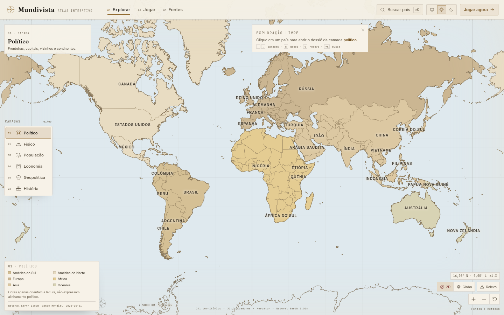

# Mundivista

> Atlas interativo de geografia, geopolítica e dados. O mapa é a interface — não o fundo.

**Status:** P0 e P1 do roadmap executados. 77 testes, `svelte-check` sem erros, build estático,
auditoria axe sem violações sérias e smoke test de interação em Firefox.



## Rodar

```bash
npm install
npm run dev        # http://localhost:5173
npm run build      # build estático em build/
npm run preview
```

Verificações:

```bash
npm test           # 77 testes (motores, dados, timeline, i18n)
npm run check      # svelte-check, 0 erros
npm run build      # prerender + adapter-static
npm run smoke      # interação real no preview (Playwright/Firefox)
npm run a11y       # axe-core: WCAG 2.1 AA, sem violações sérias
npm run shots      # screenshots desktop/mobile claro/escuro em docs/screenshots
```

O `smoke`, `a11y` e `shots` esperam um preview em `http://localhost:4173`.

## O que existe

### Identidade — Atlas Editorial

- Papel frio, tinta verde, ametista e verde-floresta; modo escuro como o mesmo atlas à noite. O azul
  fica reservado à água dentro dos mapas; fora deles a interface usa a paleta editorial.
- Display serifada (Newsreader), UI em Instrument Sans e dados em IBM Plex Mono.
- Conjunto próprio de ícones cartográficos (24 px, traço 1,5): rosa dos ventos, curva de
  nível, marco de fronteira, rio, densidade, aliança, linha do tempo.
- Réguas, ticks, numeração de seção e textura sutil de papel no lugar de glassmorphism.
- Tema claro/escuro/sistema persistido em `localStorage`, aplicado antes do primeiro paint.

### Atlas

- Mapa MapLibre com 197 países e 44 territórios (241 entidades), Natural Earth 1:50m, rios,
  lagos, litoral, cidades e nomes de oceanos, mares, baías e golfos.
- Abre no **mapa base 2D em Robinson** (forma e área equilibradas), sem camada temática ativa. As
  seis camadas — político, físico, demografia, economia, geopolítica e história — são
  escolhidas no filtro de camadas; clicar de novo na camada ativa volta ao mapa padrão.
- Pan **horizontal infinito** no 2D: arrastar para leste ou oeste dá a volta no mundo; cima e
  baixo param nos polos. No 2D o mar continua além da borda para o mapa seguir como uma
  câmera, sem revelar uma moldura; no globo 3D, o espaço estrelado fica fora do planeta.
- Globo 3D e relevo opcionais, alternáveis no canto inferior direito.
- HUD com filtro de camadas recolhível (com memória), legenda contextual recolhível e um
  único grupo de controles com coordenadas, zoom, projeção e relevo. Alvos de toque maiores
  e tipografia mais legível no mapa e nos painéis.
- Na camada política, clicar em um país carrega sob demanda suas **unidades administrativas
  de primeiro nível** (estados, províncias, distritos): contornos e nomes sobre o mapa e
  lista navegável no card, com foco no mapa ao escolher uma unidade.
- O card do país é uma **ficha contínua com abas-índice**: visão geral com gráfico em
  destaque, ficha, vizinhos, demografia, economia, físico, geopolítica e história na
  mesma rolagem, com números maiores, ícones e CTA fixo para o dossiê.
- O **dossiê** abre com capa editorial: silhueta do país, mapa de localização no hero,
  ledger de métricas, navegação fixa, gráficos interativos (linha/área/barras com eixos,
  mediana mundial e tooltip) e cards com animações.
- **Comparação** em painel largo: barras divergentes por indicador e radar de percentis,
  com seletor de país, hover sincronizado e animação de entrada.
- **Economia** com maiores empresas (amostra curada e explícita), comércio exterior,
  produtos/parceiros e links para OEC/CompaniesMarketCap.
- i18n cobre shell, portal, Explore, card, dossiê, Países, Play e Sobre em PT/EN; o
  conteúdo interno dos jogos ainda está em português.
- Coropléticos por quantis, crossfade de camada, seleção por diferença de `feature-state`,
  hover em `requestAnimationFrame` com bbox de 4–6 px.
- Rótulos DOM com cache de medida, colisão, prioridade e teto de 82; microestados ganham
  pontos de capital e todos os países pequenos têm área de acerto ampliada.
- Escala gráfica, rosa dos ventos, leitura de coordenadas e projeção no canto do mapa.
- Linha do tempo 1945–2026 na camada de história, com recorte de blocos e fontes por evento.
- Territórios com estatuto disputado recebem hachura e nota curada, sem atribuição de soberania.
- Busca global (⌘K) por país, camada ou jogo.
- Portal inicial com opções grandes em caixa alta (Explorar, Jogar, Países, Sobre) sobre o
  mapa-múndi, e painel de configurações com idioma PT/EN, tema, som e tamanho do texto.
- Índice navegável de países em `/paises`, com busca, continente, bandeira e população.

### Dossiês

- Territórios dependentes mostram o soberano (ex.: Groenlândia → Dinamarca) no card e no dossiê.
- Card de país reorganizado em camadas de leitura: cabeçalho com identidade, quatro
  métricas-chave, abas curtas em uma linha e, dentro de cada aba, cartões de indicador
  (valor, ano, percentil) em grade. Vizinhos, unidades e leituras ficam em blocos próprios.
- Dossiê com hero, faixa de resumo, navegação de seções com estado ativo, cards de seção e
  métricas com série embutida; barra lateral fixa com mapa, comparação e metadados.
- Bottom sheet no mobile com snap points (peek/half/full) e arraste.
- Link direto para `/country/[code]` com ficha técnica, indicadores por seção, séries,
  comparação entre países, linha do tempo, organizações, leituras e fontes.
- Compartilhamento de país/camada via URL (`/explore?country=BRA&layer=economy`).

### Jogos

| Jogo | Mecânica |
| --- | --- |
| Países do Mundo | clicar no país no mapa |
| Capitais | resposta digitada (PT/EN) |
| Rankings do Mundo | montar o top 5 por indicador clicando na ordem |
| Blocos e Alianças | seleção múltipla + intruso |
| Sem Litoral | escolher entre países destacados |
| Silhuetas | reconhecer o país pelo contorno |
| Cadeia de Fronteiras | vizinhos, intrusos e países do mesmo continente |
| Bandeiras | reconhecer o país pela bandeira |
| Economia em Números | maior/menor PIB, inflação, desemprego e outros |

- Motor de jogo independente do mapa: rodadas, regras, validação e pontuação.
- Biblioteca com capa visual própria por jogo (bandeiras, silhueta, gráficos, mapa) e tema
  de cor por categoria; a introdução e o cabeçalho de cada jogo repetem o ícone e a capa.
- Sala de jogos com capas grandes, tipografia de arcade, categorias, dificuldade,
  progresso, “continuar jogando” e recordes.
- Onboarding de uma tela por mecânica, modo lista acessível, atalhos 1–4, feedback com fonte.
- Bandeiras e Economia em Números entre os clássicos; 9 jogos no total.
- Sons sintetizados (WebAudio) para clique, acerto, erro e fim de jogo, com botão de mudo.
- Count-up de pontos, pulso de acerto/erro e resultado com stagger.
- Desafio diário com seed determinístico por data e compartilhamento sem spoiler.
- Progresso de rodada persistido localmente, inclusive feedback pendente.

### Dados

- **Natural Earth 1:50m / 1:110m** (domínio público): fronteiras, nomes em pt-BR, rios,
  lagos, litoral, capitais e cidades.
- **Natural Earth Admin 1 (1:10m)** (domínio público): unidades administrativas de primeiro
  nível por país, simplificadas em arquivos carregados sob demanda.
- **mledoze/countries** (ODbL): capital, moeda, área, idiomas e vizinhos.
- **World Bank Open Data** (CC BY 4.0): 32 indicadores, série 2016–2025, observação mais
  recente por país com ano preservado. Inclui WGI (governança) e séries para sparklines.
  Códigos históricos do recorte Natural Earth são normalizados (ZAR→COD, ROM→ROU,
  TMP→TLS, WBG→PSE) para não perder países como República Democrática do Congo, Noruega,
  Romênia, Timor-Leste, Palestina e Nauru.
- **UN DESA — World Population Prospects 2024** (CC BY 3.0 IGO): população total e
  densidade da variante média para países e territórios sem série no Banco Mundial
  (Taiwan, Vaticano, Anguilla, Ilhas Cook, Malvinas, Sara Ocidental e outros). O valor
  mantém o ano e a fonte alternativa aparece no dossiê.
- **Curadoria Mundivista** (fatos pontuais com fonte): Somalilândia não herda dados da
  Somália; capital, área, moeda e línguas vêm de fonte própria. A moeda da Micronésia
  (dólar americano) também é complementada.
- **AWS Terrain Tiles** (dados públicos): modelo digital de elevação carregado sob demanda.

Nenhum valor é estimado pelo app: lacuna aparece como “não disponível”. O pipeline é
reproduzível:

```bash
npm run data:build        # usa cache
npm run data:refresh      # baixa tudo de novo
npm run data:subdivisions # estados/províncias (Natural Earth 1:10m)
```

## Estrutura

```
src/
├── lib/
│   ├── components/{map,cards,navigation,games,ui}/
│   ├── configurations/map-layers.ts
│   ├── data/{generated,countries,organizations,historical,snippets,disputed,timeline}/
│   ├── engines/{map-engine,game-engine,scoring-engine}/
│   ├── progress.ts          # progresso/recordes/desafio diário
│   ├── theme.svelte.ts      # claro/escuro/sistema
│   └── i18n.ts              # estrutura PT/EN do shell
└── routes/{explore,country/[code],play,game/[slug],sobre}
tools/
├── build-data.mjs           # pipeline de dados
├── build-subdivisions.mjs   # unidades administrativas por país
├── screenshots.mjs          # screenshots comparáveis
├── smoke.mjs                # interação real
└── a11y.mjs                 # axe-core
```

O motor de jogos não importa o mapa. O mapa é um renderizador entre outros possíveis.

## Limitações conhecidas

- Natural Earth 1:50m: fronteiras generalizadas; microestados usam pontos de capital.
- Unidades administrativas vêm do Natural Earth 1:10m e são simplificadas: o nível
  disponível varia por país (estado, província, distrito ou município) e os contornos não
  substituem uma base oficial.
- O relevo sombreado e o modo 3D dependem de tiles públicos carregados pela rede e ficam
  disponíveis no globo; o modo 2D Robinson é plano e não usa DEM.
- Blocos históricos e a linha do tempo usam os polígonos atuais; não são fronteiras do período.
- Bathymetria, fluxos comerciais e biomas/clima ainda não estão implementados.
- Indicadores em dólares correntes não são comparáveis entre anos sem ajuste; o ano é sempre exibido.
- Todos os 197 países do atlas têm população; onde o Banco Mundial não publica série,
  população e densidade vêm da UN WPP 2024. Dez territórios seguem sem série: cinco não
  têm população permanente (Siachen, Heard, Geórgia do Sul, Terras Austrais e
  Chagos) e cinco são pequenos ou de estatuto não reconhecido (Åland, Norfolk,
  Pitcairn, Chipre do Norte e Somalilândia). A lacuna é explícita, não estimada.
- HDI, corrupção (TI) e liberdade (Freedom House/RSF) não foram adicionados: exigem revisão
  de licença e metodologia fora do Banco Mundial.
- A interface do shell, portal, Play e configurações está em PT/EN; o conteúdo editorial
  dos dossiês e dos jogos segue em português nesta versão.
- Sem autenticação, ranking global, backend ou PWA.

## Documentação

- [`docs/ROADMAP.md`](docs/ROADMAP.md) — backlog priorizado, status e critérios de aceite.
- [`docs/INSPIRATION.md`](docs/INSPIRATION.md) — referências, anti-padrões e direção escolhida.
- [`docs/HANDOFF.md`](docs/HANDOFF.md) — estado técnico, decisões e o que continua aberto.

## Próximos passos

1. Licenciar e integrar HDI, corrupção e liberdade; avaliar Comtrade para fluxos.
2. Biomas/clima (Köppen/Beck) e bathymetria com tiles próprios.
3. Playwright como suíte de regressão visual em CI, com thresholds de performance.
4. i18n completo EN e revisão editorial.
5. P2: backend/PostGIS, contas, editor de jogos e ranking global.
